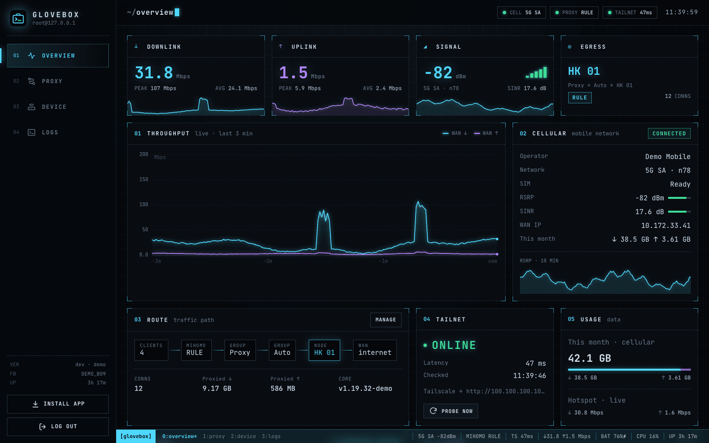
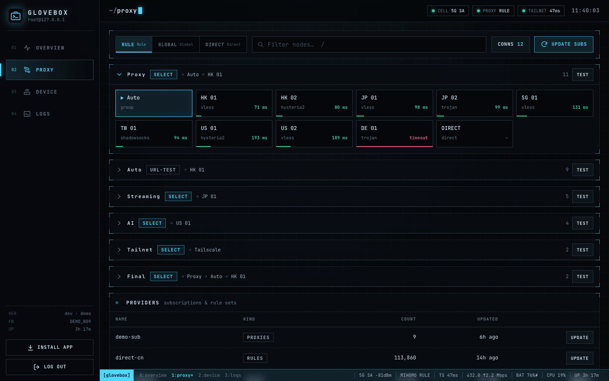
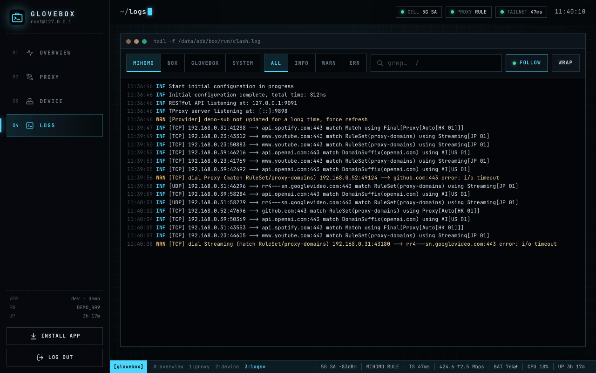
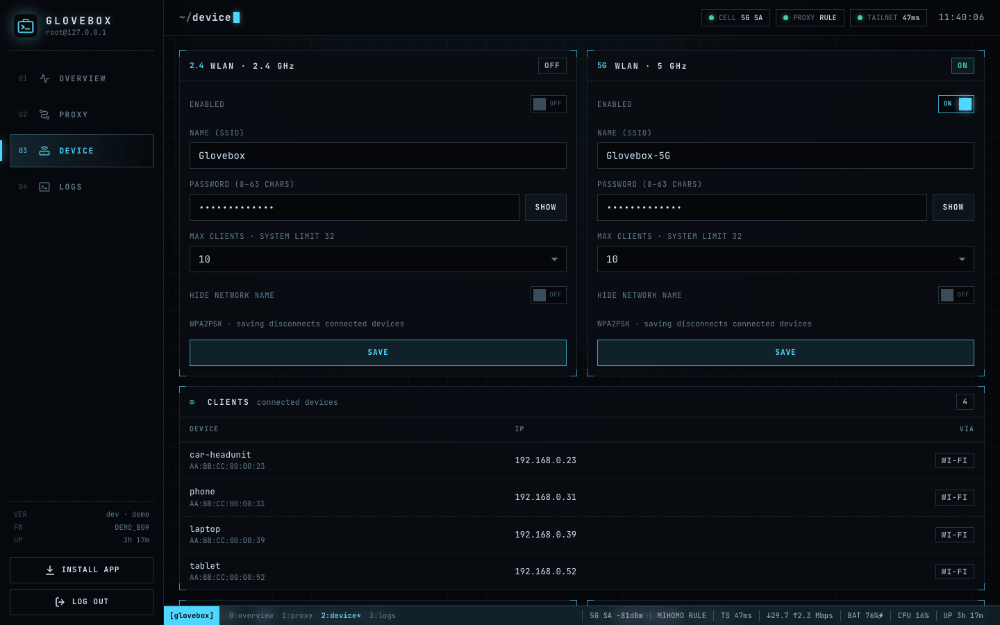
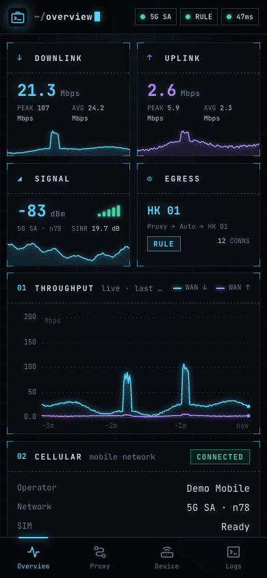

# Glovebox

[](https://github.com/Cluas/glovebox/actions/workflows/ci.yml)

**A LuCI-style web console for rooted Android mobile routers.** Glovebox runs as root on the
stock firmware of a pocket 5G/4G Wi-Fi router and gives you one place to watch the cellular link,
manage the hotspot, drive a [mihomo](https://github.com/MetaCubeX/mihomo) proxy and read logs —
without flashing OpenWrt.

English · [简体中文](README.zh-CN.md)



- **Single static binary**, web UI embedded, no runtime dependencies. Packaged as a Magisk module.
- **Works with the stock firmware**: talks to the vendor web API (ZTE goform), mihomo's REST API
  and `/proc`, `/sys` — the vendor UI and apps keep working.
- **Installable app (PWA)** with a responsive layout for desktop, tablets, phones (portrait and
  landscape) and in-vehicle / embedded browsers. HTTPS via a generated, name-constrained local CA.
- **Internationalized** (English, 简体中文); adding a language is adding one JSON file.
- **Demo mode** runs the whole console on any computer with fake backends.

## Features

| Page | What you get |
| --- | --- |
| Overview | Live WAN throughput chart, signal (RSRP/SINR/band) with history, egress node and proxy chain, Tailscale reachability probe, monthly data usage, battery/CPU/memory/temperature gauges, connected clients |
| Proxy | mihomo groups and nodes, switch nodes, latency tests, rule/global/direct mode, update subscriptions and rule sets, live connections with filter and "close all" |
| Device | Hotspot SSID/password/visibility/on-off per band, max clients (up to the system limit), connected devices, HTTPS & app install guide, restart proxy, reboot, sync the device clock, console password, theme/language |
| Logs | mihomo, Box for Root, Glovebox and Android logcat — level filter, grep with highlight, follow/pause, wrap |

Keyboard: `1`–`4` switch pages, `/` focuses the filter.

<p>


</p>
<p>


</p>

## Supported devices

Glovebox currently targets the **ZTE F50** (Unisoc platform, Android 13, firmware B09) and the
vendor stack it ships with. Anything that talks to the hardware is behind small clients
(`zte.go`, `mihomo.go`, `sys.go`), so other Android-based routers can be added — contributions are
welcome.

Requirements on the device:

- Root with [Magisk](https://github.com/topjohnwu/Magisk)
- Optional: [Box for Root](https://github.com/taamarin/box_for_magisk) running mihomo with the
  external controller on `127.0.0.1:9091` (the proxy page and charts degrade gracefully without it)

## Install

1. Download `glovebox-<version>.zip` from the [releases page](https://github.com/Cluas/glovebox/releases) (or [build it](#build)) and install it
   in the Magisk app, then reboot.
2. Set the console password (once):

   ```sh
   adb shell su -c "'echo YOUR-PASSWORD | /data/adb/modules/glovebox/bin/glovebox passwd'"
   ```

3. Join the hotspot and open **http://192.168.0.254**. Glovebox adds this address to `br0` (the
   vendor DHCP pool ends at .253) so it never collides with the vendor UI on 192.168.0.1.

For a friendly name, resolve `glovebox.lan` to `192.168.0.254`, e.g. with mihomo:

```yaml
hosts:
  glovebox.lan: 192.168.0.254
```

### HTTPS and installing as an app

Browsers only install PWAs from secure origins. On first start Glovebox creates a local root CA in
`/data/adb/glovebox/tls/` and serves HTTPS on `192.168.0.254:443`. The CA is **name-constrained**
to the configured hostnames and listen IPs, so it cannot sign certificates for any other site even
if its key leaks. The Device page has a download button and step-by-step instructions for iOS,
Android, macOS and Windows; compare the SHA-256 fingerprint shown there before trusting it.

Prefer your own certificate? Set `tls_cert` / `tls_key`.

### Hotspot client limit

Vendor resource overlays cap the SoftAP at 10 clients
(`config_wifiHardwareSoftapMaxClientCount`). The module ships a static runtime resource overlay
(`com.glovebox.wifi.overlay`, priority 900) that raises it to 32; the Device page offers values
up to the limit the system reports (`dumpsys wifi`). The real ceiling also depends on the Wi-Fi
firmware. Build with `NO_OVERLAY=1` to leave the vendor limit alone. If the hotspot misbehaves,
delete `/data/adb/modules/glovebox/system` and reboot.

## Configuration

`/data/adb/glovebox/config.json` stores only values that differ from the defaults. Inspect the
effective configuration with `glovebox config`, merge changes with `glovebox config import`, then
restart (`su -c 'pkill -f bin/glovebox'`; the supervisor starts it again):

```sh
echo '{"tailscale_proxy":"Tailscale","tailscale_probe":"http://100.64.0.1/"}' \
  | su -c '/data/adb/modules/glovebox/bin/glovebox config import'
```

| Key | Default | Description |
| --- | --- | --- |
| `listen` | `["192.168.0.254:80"]` | HTTP listen addresses |
| `tls_listen` | `["192.168.0.254:443"]` | HTTPS listen addresses; empty disables HTTPS |
| `tls_cert`, `tls_key` | | Custom certificate and key (PEM) instead of the local CA |
| `hostnames` | `["glovebox.lan"]` | Names in issued certificates; the first is used for the HTTPS link |
| `alias_addr`, `alias_dev` | `192.168.0.254/32`, `br0` | Address Glovebox adds to the LAN bridge; empty disables it |
| `allow_cidrs` | `["192.168.0.0/24","127.0.0.0/8"]` | Source networks allowed to connect |
| `zte_base`, `zte_db` | `http://192.168.0.1:8080`, vendor DB path | Vendor web API and the database holding its login hash |
| `mihomo_api`, `mihomo_secret` | `http://127.0.0.1:9091` | mihomo external controller |
| `main_group` | first visible selector | Proxy group shown on the overview |
| `box_dir` | `/data/adb/box` | Box for Root directory (logs, restart script) |
| `tailscale_proxy`, `tailscale_probe` | | mihomo outbound and a tailnet URL to probe through it; both enable the Tailnet card |
| `delay_url` | `https://www.gstatic.com/generate_204` | URL for latency tests |
| `wan_prefixes`, `lan_dev` | `sipa_eth`, `rmnet`, `ccmni` / `br0` | Interfaces used for traffic rates |

Files in `/data/adb/glovebox/`: `config.json`, `glovebox.log` (rotated at 1 MiB),
`stdout.log` (output of the supervisor in `service.sh`) and `tls/` (the local CA). They survive
module upgrades and uninstalls.

## How it works

```
 browser ──HTTP/HTTPS──▶ glovebox (root, 192.168.0.254)
                           ├─ vendor web API   192.168.0.1:8080  (signal, SIM, usage, clients, Wi-Fi)
                           ├─ mihomo REST API   127.0.0.1:9091   (groups, nodes, providers, connections)
                           ├─ /proc, /sys                       (rates, CPU, memory, battery, thermal)
                           └─ shell                              (box.service, logcat, reboot, date)
```

The vendor login hash is read from the vendor database instead of storing the admin password; a
hash that failed once is never retried, to avoid tripping the vendor lockout. Writes carry the
vendor's request signature (`AD`). The vendor firewall only admits 192.168.0.0/24 to port 8080,
which is why Glovebox talks to 192.168.0.1 rather than loopback.

## Security

- The console only accepts connections from `allow_cidrs` (the hotspot LAN by default).
- Passwords are stored as PBKDF2-SHA256; sessions are HMAC-signed cookies that become invalid
  when the password changes. Failed logins lock out with exponential back-off.
- State-changing requests require an `X-Glovebox: 1` header (CSRF protection); responses carry a
  strict Content-Security-Policy.
- Glovebox runs as root and can reboot the device and change Wi-Fi settings — treat the console
  password accordingly. See [SECURITY.md](SECURITY.md) to report issues.

## Build

Requires Go 1.24+. The overlay additionally needs Android SDK build-tools and a platform
`android.jar` (`overlay/build.sh` finds them via `ANDROID_HOME`).

```sh
./build.sh                    # dist/stage/ and dist/glovebox-<version>.zip
NO_OVERLAY=1 ./build.sh       # without the client-limit overlay
VERSION=1.0.0 ./build.sh      # explicit version
GLOVEBOX_PASSWORD_FILE=pw.txt ./deploy.sh   # push to a device over adb and restart, no reboot
```

### Demo mode

```sh
go run . demo                 # http://127.0.0.1:8080, password "glovebox"
```

Demo mode serves the real UI against in-process fakes of the vendor API and mihomo with synthetic
traffic, which is handy for UI work, screenshots and tests.

### Tests

```sh
go test ./...
```

Besides unit and API tests, the suite checks that every locale has every key and no unused ones,
that source files stay English-only, and that README translations match this file's structure.

## Translations

UI strings live in [`web/i18n`](web/i18n). To add a language, copy `en.json` to `<code>.json`,
translate the values, and add the code with its native name to `index.json`. API errors are
translated through `err.<code>` keys; unknown codes fall back to the English message. The UI
picks the browser language and can be switched on the Device page.

This README is also available as `README.<code>.md`; translations keep the same sections,
tables, code blocks and screenshots (`docs/screenshots/<code>/`), which the tests check.

## Acknowledgements

Design inspired by OpenWrt LuCI, [zashboard](https://github.com/Zephyruso/zashboard),
[metacubexd](https://github.com/MetaCubeX/metacubexd), [WebTUI](https://github.com/webtui/webtui)
and futuristic UI work collected by [daisyUI](https://trends.daisyui.com/futuristic-speculative-ui/).
Bundled font: [JetBrains Mono](https://www.jetbrains.com/lp/mono/) (SIL Open Font License 1.1,
see `web/fonts/OFL.txt`).

## License

[MIT](LICENSE). Not affiliated with ZTE, Unisoc, the mihomo project or Tailscale.
