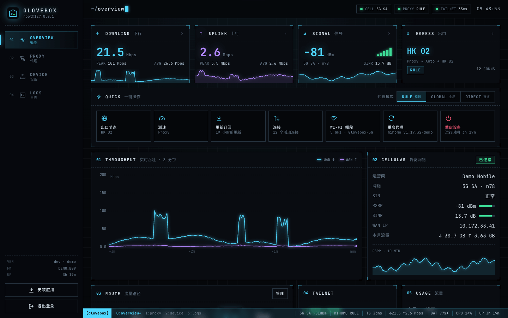
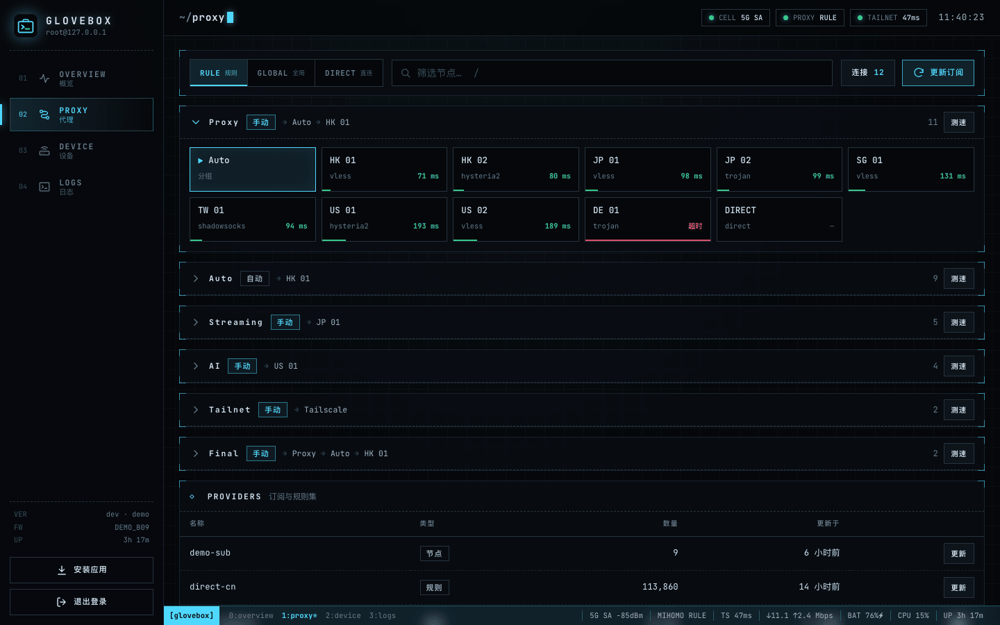
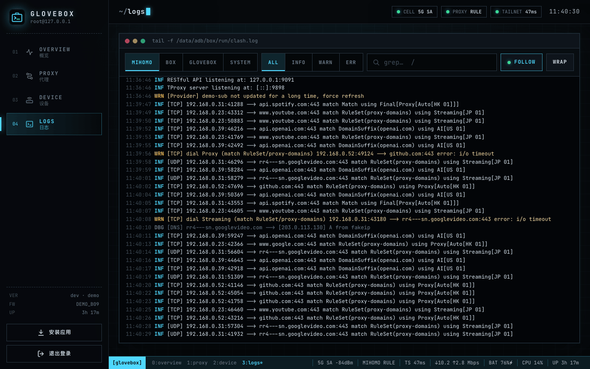
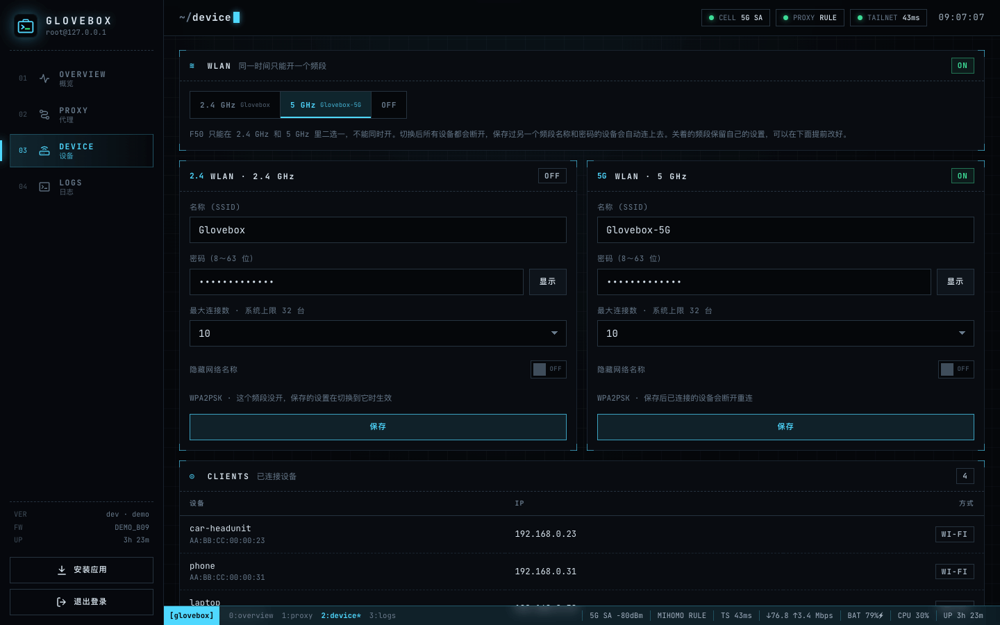
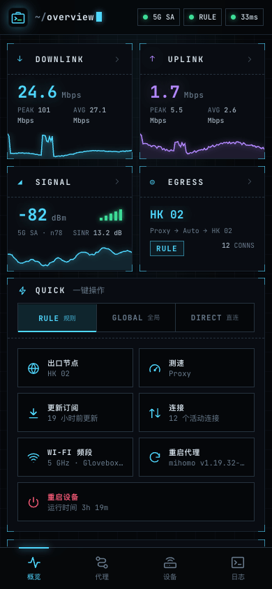
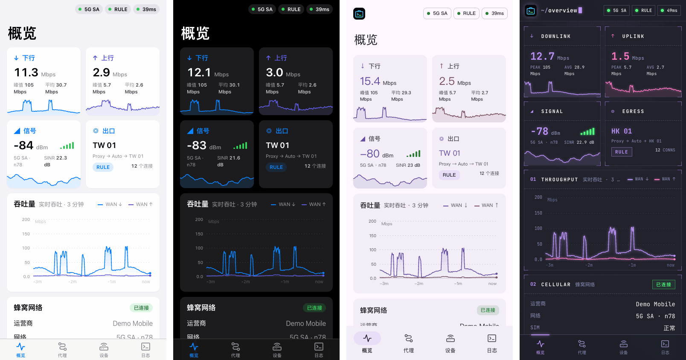

# Glovebox

[](https://github.com/Cluas/glovebox/actions/workflows/ci.yml)

**给已 Root 的 Android 移动路由器用的网页管理后台，定位类似 OpenWrt 的 LuCI。** Glovebox 以 root
身份跑在随身 5G/4G Wi-Fi 的原厂系统上，把蜂窝网络状态、热点管理、[mihomo](https://github.com/MetaCubeX/mihomo)
代理和各类日志集中到一个页面里，不需要刷 OpenWrt。

[English](README.md) · 简体中文



- **单个静态二进制**，网页内嵌，没有运行时依赖，打包成 Magisk 模块。
- **基于原厂系统**：读写原厂网页接口（ZTE goform）、mihomo REST API 和 `/proc`、`/sys`，
  原厂网页和应用照常可用。
- **可安装为应用（PWA）**，桌面、平板、手机（横竖屏）和车机等嵌入式浏览器都有对应布局；
  HTTPS 由自动生成、带名称约束的本机 CA 提供。
- **多套主题**：iOS 和 Material You 两套外观，深浅色跟随系统；另有七套终端配色。
  第一次打开时按设备挑选：iPhone 和 iPad 用 iOS，Android 用 Material You，其它设备用终端风格。
- **多语言**（English、简体中文），加一种语言只需要加一个 JSON 文件。
- **演示模式**：用假后端在任何电脑上跑起完整控制台。

## 功能

| 页面 | 内容 |
| --- | --- |
| 概览 | 快捷操作（代理模式、出口节点、测速、更新订阅、连接、Wi-Fi 频段、重启代理、重启设备）、点卡片直达对应详情、WAN 实时吞吐曲线、信号（RSRP/SINR/频段）及历史、出口节点和代理链、Tailscale 连通性探测、本月流量、电量/CPU/内存/温度、已连接设备、健康检查及其事件 |
| 代理 | mihomo 分组和节点、切换节点、测速、规则/全局/直连模式、更新订阅和规则集、实时连接（可筛选、一键断开） |
| 设备 | 热点频段（2.4 GHz 或 5 GHz，F50 同一时间只能开一个）或关闭，每个频段的名称/密码/隐藏、最大连接数（不超过系统上限）、已连接设备、短信（收件箱、发短信、验证码推送到 Telegram 或 WhatsApp）、告警和日志推送状态、软件更新、远程诊断结果、HTTPS 与安装指引、重启代理、重启设备、校正设备时间、控制台密码、主题、深浅色和语言 |
| 日志 | mihomo、Box for Root、Glovebox、Android logcat；级别筛选、grep 高亮、跟随/暂停、自动换行 |

键盘：`1`–`4` 切换页面，`/` 聚焦筛选框。

<p>


</p>
<p>


</p>
<p>

</p>

## 支持的设备

目前适配 **ZTE F50**（展锐平台，Android 13，B09 固件）及其原厂软件栈。和硬件打交道的部分都封装在
几个小客户端里（`zte.go`、`mihomo.go`、`sys.go`），适配其它基于 Android 的路由器只需要补对应实现，欢迎贡献。

设备需要：

- 用 [Magisk](https://github.com/topjohnwu/Magisk) Root
- 可选：[Box for Root](https://github.com/taamarin/box_for_magisk) 运行 mihomo，external-controller
  监听 `127.0.0.1:9091`（没有也能用，代理页和相关图表会降级显示）

## 安装

1. 从 [Releases 页面](https://github.com/Cluas/glovebox/releases)下载 `glovebox-<版本>.zip`（或[自己编译](#编译)），在 Magisk 里安装后重启。
2. 设置控制台密码（只需一次）：

   ```sh
   adb shell su -c "'echo 你的密码 | /data/adb/modules/glovebox/bin/glovebox passwd'"
   ```

3. 连上热点，打开 **http://192.168.0.254**。Glovebox 会把这个地址加到 `br0` 上（原厂 DHCP
   地址池只到 .253），不会和 192.168.0.1 上的原厂网页冲突。

想用域名访问，就把 `glovebox.lan` 解析到 `192.168.0.254`，比如在 mihomo 配置里：

```yaml
hosts:
  glovebox.lan: 192.168.0.254
```

### HTTPS 与安装为应用

浏览器只允许从安全来源安装 PWA。Glovebox 第一次启动时在 `/data/adb/glovebox/tls/` 生成本机根证书，
并在 `192.168.0.254:443` 提供 HTTPS。根证书带**名称约束**，只能给配置的域名和监听 IP 签发证书，
即使私钥泄露也不能用来冒充其它网站。「设备」页有下载按钮和 iOS、Android、macOS、Windows 的分步说明，
信任之前请核对页面上显示的 SHA-256 指纹。

想用自己的证书？设置 `tls_cert` / `tls_key` 即可。

### 热点连接数上限

厂商的资源覆盖包把热点上限写死为 10 台（`config_wifiHardwareSoftapMaxClientCount`）。模块里带了一个
静态运行时资源覆盖包（`com.glovebox.wifi.overlay`，优先级 900），把上限改为 32；「设备」页的最大连接数
选项以系统实际报告的上限（`dumpsys wifi`）为准。真正能连多少台还取决于 Wi-Fi 固件。编译时加
`NO_OVERLAY=1` 可以保留厂商上限。如果热点异常，删除 `/data/adb/modules/glovebox/system` 后重启即可恢复。

## 配置

`/data/adb/glovebox/config.json` 只保存和默认值不同的字段。用 `glovebox config` 查看当前生效的配置，
用 `glovebox config import` 合并修改，然后重启程序（`su -c 'pkill -f bin/glovebox'`，守护脚本会自动拉起）：

```sh
echo '{"tailscale_proxy":"Tailscale","tailscale_probe":"http://100.64.0.1/"}' \
  | su -c '/data/adb/modules/glovebox/bin/glovebox config import'
```

| 字段 | 默认值 | 说明 |
| --- | --- | --- |
| `listen` | `["192.168.0.254:80"]` | HTTP 监听地址 |
| `tls_listen` | `["192.168.0.254:443"]` | HTTPS 监听地址；为空则关闭 HTTPS |
| `tls_cert`, `tls_key` | | 用自己的证书和私钥（PEM），不用本机 CA |
| `hostnames` | `["glovebox.lan"]` | 签发证书时包含的域名；第一个用于 HTTPS 链接 |
| `alias_addr`, `alias_dev` | `192.168.0.254/32`, `br0` | 加到局域网网桥上的地址；为空则不加 |
| `allow_cidrs` | `["192.168.0.0/24","127.0.0.0/8"]` | 允许连接的来源网段 |
| `zte_base`, `zte_db` | `http://192.168.0.1:8080`, 原厂数据库路径 | 原厂网页接口，以及存放其登录哈希的数据库 |
| `mihomo_api`, `mihomo_secret` | `http://127.0.0.1:9091` | mihomo external controller |
| `main_group` | 第一个可见的 Selector | 概览页显示的代理分组 |
| `box_dir` | `/data/adb/box` | Box for Root 目录（日志、重启脚本） |
| `tailscale_proxy`, `tailscale_probe` | | mihomo 出站名和经它访问的 tailnet 地址；两者都设置后才显示 Tailnet 卡片 |
| `delay_url` | `https://www.gstatic.com/generate_204` | 测速使用的地址 |
| `wan_prefixes`, `lan_dev` | `sipa_eth`, `rmnet`, `ccmni` / `br0` | 统计流量速率用的网卡 |
| `device_name` | `glovebox` | 告警里的设备名，也是推送日志的 `host` 标签 |
| `report_proxy` | | 告警和日志推送使用的代理，支持 `http://` 和 `socks5://` |
| `report_lang` | `en` | 告警语言，取 `web/i18n` 里的语言代码 |
| `telegram_token`, `telegram_chat` | | Telegram bot token 和 chat ID；两者都设置后启用 Telegram 告警 |
| `webhook_url` | | 每个健康事件都以 JSON POST 到这个地址 |
| `whatsapp_url`, `whatsapp_key` | | [WAHA](#短信) 地址和它的 API key；和 `whatsapp_chat` 一起设置后启用 WhatsApp |
| `whatsapp_chat` | | 在 WhatsApp 上收短信的号码（国际格式）或 WAHA 的 chat ID |
| `whatsapp_session` | `default` | 用来发送的 WAHA 会话 |
| `sms_forward` | `telegram`, `whatsapp`, `webhook` | 新短信推送到哪些渠道；为空则不推送 |
| `log_push_url` | | 日志和事件的 Loki 推送地址；URL 里的 `user:password@` 作为 Basic 认证发送 |
| `dns_probe` | `127.0.0.1:1053` | DNS 检查要询问的 mihomo DNS 监听地址；为空则跳过这一项 |
| `update_url` | GitHub 最新 Release 的 `update.json` | [远程升级](#远程升级)检查的签名清单地址；为空则关闭远程升级 |
| `update_mode` | `auto` | `auto` 自动安装新版本，`notify` 只提醒，`off` 不再检查 |
| `update_interval` | `1h` | 检查间隔；启动 2 分钟后检查第一次 |
| `update_pubkeys` | | 额外信任的 ed25519 签名公钥（base64） |
| `diag_url` | `auto` | 拉取的签名[诊断任务](#远程诊断)；`auto` 表示自建 `update_url` 同目录下的 `diag/<device_name>.json`，为空则关闭 |
| `diag_interval` | `1m` | 拉取间隔，最短 `15s`；执行完任务后的 10 分钟内每 15 秒一次 |

`/data/adb/glovebox/` 下的文件：`config.json`、`glovebox.log`（超过 1 MiB 轮转）、`stdout.log`
（`service.sh` 守护进程的输出）、`tls/`（本机 CA）、`events.jsonl`（健康事件）、`clock`（最后一次
可信的时间）、`notify.json` / `ship.json`（告警和日志推送的进度）、`sms.json`（推送到哪条短信了）、`update/`（下载的安装包、上一个版本和升级状态）、`diag.log`（诊断结果，超过 256 KiB 轮转）
以及 `diag/`（执行过的任务）。升级或卸载模块都不会删除它们。

## 健康检查与上报

Glovebox 每 30 秒检查一次：mihomo、它的 DNS（热点客户端被转发到的监听端口，以及后面的上游服务器）、
主代理分组、Tailscale、蜂窝数据、热点、时钟和剩余内存。连续两轮失败才算异常（蜂窝数据要持续 5 分钟，
短暂没信号不会报），一轮正常就算恢复。依赖项异常时，依赖它的检查会跳过，告警只报根因：mihomo 挂了
不再报 DNS 和代理，蜂窝数据断了不再报代理。概览页列出各检查项和它们的状态变化。

F50 没有 RTC 电池，断电后开机时间会回到很早的日期，直到蜂窝网络授时。Glovebox 发现时钟比上次见到的
时间还早时，会暂停告警和日志推送，等时间校正后再补发，并修正这段时间里事件的时间戳。

事件可以通过三个可选渠道上报，在配置里填好对应字段就会启用：

- **Telegram**：用 [@BotFather](https://t.me/BotFather) 创建 bot，给它发一条消息，再从
  `https://api.telegram.org/bot<token>/getUpdates` 里找到 chat ID。异常告警会附上 mihomo 最近的警告日志。
- **Webhook**：每个事件以 JSON POST 一次（`device`、`time`、`check`、`state`、`msg`、`dur`、
  `text`）。
- **日志**：mihomo、Box for Root、Glovebox 的日志和健康事件按 Loki 推送协议发送，Grafana Loki、
  VictoriaLogs、Grafana Alloy 都能接收。日志文件本身就是缓冲：服务器确认收到后才算发出，没信号时
  写下的日志之后会补发。每个事件是一行 JSON，包含 `check`、`state`、`msg`、`dur`，`_msg` 里是
  `dns fail: timeout` 这样的摘要（VictoriaLogs 把 `_msg` 当作日志正文）。

没送出去的告警和日志会退避重试，重启或断电后也会继续。「设备」页显示每个渠道的状态，也可以发一条
测试消息。

Box for Root 会让设备自己发往私有地址的流量绕过 mihomo。要经 tailnet 访问家里的服务器，就把
`report_proxy` 设为 mihomo 的 mixed 端口，并在 mihomo 规则里为服务器地址指定出站：

```sh
echo '{"device_name":"router","report_proxy":"http://127.0.0.1:7890",
  "telegram_token":"123456:ABC-DEF","telegram_chat":"42",
  "log_push_url":"http://192.168.1.10:9428/insert/loki/api/v1/push"}' \
  | su -c '/data/adb/modules/glovebox/bin/glovebox config import'
```

下面是保留 30 天的 VictoriaLogs 服务器；网页界面在 `http://<主机>:9428/select/vmui`，
查询 `source:mihomo` 看 mihomo 日志，`source:events` 看健康事件：

```sh
docker run -d --name victorialogs --restart unless-stopped -p 9428:9428 \
  -v victorialogs:/vlogs victoriametrics/victoria-logs:v1.53.0 \
  -storageDataPath=/vlogs -retentionPeriod=30d
```

## 短信

「设备」页可以看 SIM 卡收到的短信、发短信和删短信，「设备」标签上显示未读数。Glovebox 每 15 秒经原厂
网页接口读一次。每条新短信都会生成一个 `sms` 事件，推送到 `sms_forward` 里列出的渠道：

- **Telegram**（告警用的 bot）：发件人和时间，验证码单独一行（点一下就能复制），下面是全文。
- **WhatsApp**：经你自己运行的 [WAHA](https://waha.devlike.pro)（WhatsApp HTTP API）发送，它以「已关联
  设备」的身份登录一个 WhatsApp 号。验证码放在最前面。这个渠道只发短信，不发健康告警。
- **Webhook**：事件 JSON 里多一个 `sms` 对象（`id`、`from`、`text`、`code`、`at`）。

验证码是指「验证码」「code」「OTP」这类词附近的 4 到 8 位数字，或者 `615-204` 这样的两组三位数字。
第一次启动前就在 SIM 卡里的短信不会推送，设备自己发出的也不会。短信正文不进上报的日志，也不出现在
概览页的健康事件里；上报的事件只写发件人。

下面是用轻量 GOWS 引擎的 WAHA；打开 `http://<主机>:3000/dashboard`，启动 `default` 会话，在 WhatsApp 的
「设置 → 已关联的设备」里扫它的二维码：

```sh
docker run -d --name waha --restart unless-stopped -p 3000:3000 \
  -e WHATSAPP_DEFAULT_ENGINE=GOWS -e WAHA_API_KEY=<random key> \
  -e WAHA_DASHBOARD_USERNAME=admin -e WAHA_DASHBOARD_PASSWORD=<password> \
  -v waha:/app/.sessions devlikeapro/waha:gows
echo '{"whatsapp_url":"http://192.168.1.10:3000","whatsapp_key":"<random key>",
  "whatsapp_chat":"8613800000000"}' | su -c '/data/adb/modules/glovebox/bin/glovebox config import'
```

`whatsapp_chat` 是收消息的号码。WAHA 登录的是你自己的号时就填自己的号码，消息会出现在「给自己发消息」
的对话里，WhatsApp 对这种消息可能不提醒。WAHA 不是官方客户端，WhatsApp 可能限制它认为异常的账号，
用另一个号来发更稳妥。和其它渠道一样，设备经 `report_proxy` 访问 WAHA。发短信可能要花钱，控制台会先
确认；号码只能是数字，开头可以带 `+`，每条最多 500 个字。

## 远程升级

Glovebox 会定时检查 `update_url` 上有没有新版本，有就自己安装，修好的版本不用插 adb 就能送到在路上的设备。
升级由设备主动拉取，不需要从外面连进设备，所以在蜂窝网络的 CGNAT 后面也能用。

1. 每隔 `update_interval`，Glovebox 经 `report_proxy` 拉取 `update.json`。清单里写着版本号、模块 zip
   的 SHA-256 和大小，并带有对这些内容的 ed25519 签名。没有签名、公钥不受信任、或者版本不比当前新的清单都会被忽略。
2. zip 下载到 `/data/adb/glovebox/update/`，核对签名里的 SHA-256 和大小。只取出 `bin/glovebox`、
   `module.prop` 和模块脚本，新二进制还要能运行并报出预期的版本号。
3. 当前文件先复制到 `update/prev/`，再换成新文件，然后控制台重启。整个过程大约 5 秒，代理和 Wi-Fi 不受影响。
4. 新版本稳定运行一分钟后确认升级。如果 3 分钟内没有确认（崩溃、卡死或根本没起来），留下来当守护进程的旧版本会还原旧文件。
   如果期间设备断电，下次开机时 `service.sh` 发现新版本连续三次很快退出，也会还原。回滚过的版本不会再被自动安装，手动安装可以重试。

每个结果都会记成一条健康事件，Telegram 和 webhook 会收到「已升级 A → B」「升级失败」（附原因），
`notify` 模式下还会收到「有新版本 X」。设备页的「软件更新」面板显示当前状态，也可以手动检查和安装。

热点连接数 overlay（`system/`）不走这个流程，因为它要重启设备才生效；改了它的版本请用模块 zip 或 `deploy.sh` 安装。

### 发布自己构建的版本

官方 Release 在 CI 里用编译进 Glovebox 的密钥签名。要推送自己构建的版本，先生成一次密钥，让设备信任它，
再把签名清单和 zip 一起放到设备能访问的任意 HTTP 服务器上（设置了 `report_proxy` 时经它访问）：

```sh
go run . update keygen -out update-signing.key    # prints the public key; keep the file private
# on the device: trust the key and point it at your server
echo '{"update_pubkeys":["<public key>"],"update_url":"http://192.0.2.10:8088/update.json"}' \
  | su -c '/data/adb/modules/glovebox/bin/glovebox config import'
./build.sh
go run . update sign -key update-signing.key -zip dist/glovebox-<version>.zip \
  -notes "Fix log shipping" -out update.json
# upload the zip first, then update.json
```

清单里的 `zipUrl` 可以写相对 `update.json` 的路径。fork 的仓库把密钥文件内容存进 `UPDATE_SIGNING_KEY`
secret，也能用同样的方式给自己的 GitHub Release 签名。

## 远程诊断

在路上遇到问题，比如某个网站解析不了，不用连进设备也能看它那边的情况：在家里签一个诊断任务，放在
`update.json` 旁边；设备执行后把结果随日志一起传回来。和远程升级一样，设备只主动拉取。

1. Glovebox 每隔 `diag_interval` 经 `report_proxy` 拉取一次 `diag_url`。默认值 `auto` 表示自建的
   `update_url` 同目录下的 `diag/<device_name>.json`；`update_url` 指向 GitHub 时不启用。文件不存在
   就是没有任务。
2. 任务必须由受信任的发布密钥签名、指定本设备且没有过期（`not_after` 最多比现在晚 24 小时），
   每个任务只执行一次。探测按顺序执行：最多 40 个，整个任务最长 3 分钟。
3. 每个结果写成 `/data/adb/glovebox/diag.log` 里的一行 JSON，`_msg` 是摘要，最后再写一行整个任务的
   汇总。设置了 `log_push_url` 时会立即上报，`source="diag"`；「设备」页显示上一个任务的结果。
4. 执行完一个任务后的 10 分钟内，设备每 15 秒拉取一次，追加的任务几秒内就能执行。

| 探测 | 做什么 |
| --- | --- |
| `dns` | 解析 `name`（`type` 为 `A`、`AAAA` 或 `HTTPS`）：一次问热点设备用的 DNS 监听端口（`dns_probe`），一次经 mihomo 自己的解析器问上游服务器 |
| `http` | 像热点设备一样经 mihomo 的 mixed 端口请求 `url`：状态码、跳转地址、TLS 版本和证书、各阶段耗时、命中的规则和代理链，或者错误原文。`follow` 跟随最多 5 次跳转，`ua` 指定 User-Agent，`body` 附上响应的前 512 字节 |
| `delay` | 用 `url`（默认 `delay_url`）测 `proxy`（节点或组）的延迟 |
| `proxies` | 每个组当前选中的节点 |
| `connections` | 热点设备当前的 mihomo 连接，设置了 `match` 时只取包含它的，最多 200 条 |
| `health` | 每项健康检查的状态 |
| `log` | 把 mihomo 日志级别临时调到 `level`（`info` 或 `debug`），持续 `minutes` 分钟（默认 10，最多 30），期间的连接和 DNS 日志会随日志上报；到期自动改回，中途重启也一样 |

```sh
cat > probes.json <<'EOF'
[{"kind":"dns","name":"accounts.google.com","type":"HTTPS"},
 {"kind":"http","url":"https://accounts.google.com/","follow":true},
 {"kind":"connections","match":"google"}]
EOF
go run . diag sign -key update-signing.key -device car -ttl 30m -in probes.json -out car.json
# upload it as diag/car.json next to update.json; the results, in VictoriaLogs:
curl http://192.0.2.10:9428/select/logsql/query --data-urlencode 'query=_time:1h source:diag job_id:"<id>"'
```

`-id` 是任务名（默认是当前时间），同一个 id 每台设备只执行一次。任务不能执行命令，`http` 拒绝设备自己的
地址（回环、链路本地、本机网卡地址、原厂网页和控制台域名，域名解析到这些地址也算）以及 `.lan` / `.local`
域名，所以碰不到控制台、mihomo 接口和原厂网页。任务唯一能改动的是临时的日志级别。注意
`connections` 和 `log` 会把热点设备访问的网站域名传到你的日志服务器。

## 工作原理

```
 browser ──HTTP/HTTPS──▶ glovebox (root, 192.168.0.254)
                           ├─ vendor web API   192.168.0.1:8080  (signal, SIM, usage, clients, Wi-Fi)
                           ├─ mihomo REST API   127.0.0.1:9091   (groups, nodes, providers, connections)
                           ├─ /proc, /sys                       (rates, CPU, memory, battery, thermal)
                           ├─ shell                              (box.service, logcat, reboot, date)
                           └─ report_proxy ──▶ Telegram, webhook, Loki push (alerts, logs)
```

原厂登录哈希直接从原厂数据库读取，不需要保存管理员密码；某个哈希登录失败一次后就不再重试，避免触发原厂的锁定。
写操作会带上原厂要求的请求签名（`AD`）。原厂防火墙只允许 192.168.0.0/24 访问 8080 端口，所以 Glovebox
访问的是 192.168.0.1 而不是回环地址。

## 安全

- 控制台只接受来自 `allow_cidrs` 的连接（默认是热点局域网）。
- 密码用 PBKDF2-SHA256 保存；会话是 HMAC 签名的 Cookie，修改密码后全部失效。登录失败过多会锁定，等待时间按指数增长。
- 修改状态的请求必须带 `X-Glovebox: 1` 请求头（防 CSRF）；响应带严格的 Content-Security-Policy。
- 远程升级只安装由受信任的 ed25519 密钥签名、且 zip 与签名里的 SHA-256 和大小一致的版本，新版本起不来会自动回滚。
- 只有登录控制台后才能看短信和发短信；短信正文不会写进上报的日志。
- 诊断任务必须由同一套密钥签名、只指定一台设备、24 小时内过期且只执行一次；除了临时的 mihomo 日志级别，探测都是只读的。
- Glovebox 以 root 运行，可以重启设备、修改 Wi-Fi 设置，请妥善保管控制台密码。报告安全问题见
  [SECURITY.md](SECURITY.md)。

## 编译

需要 Go 1.24+。覆盖包还需要 Android SDK 的 build-tools 和平台 `android.jar`（`overlay/build.sh`
通过 `ANDROID_HOME` 查找）。

```sh
./build.sh                    # 生成 dist/stage/ 和 dist/glovebox-<版本>.zip
NO_OVERLAY=1 ./build.sh       # 不带连接数覆盖包
VERSION=1.0.0 ./build.sh      # 指定版本号
GLOVEBOX_PASSWORD_FILE=pw.txt ./deploy.sh   # 通过 adb 推到设备并重启程序，不用重启设备
```

### 演示模式

```sh
go run . demo                 # http://127.0.0.1:8080，密码 glovebox
```

演示模式用进程内的原厂接口和 mihomo 假实现驱动真实界面，并生成模拟流量，方便开发界面、截图和测试。

### 测试

```sh
go test ./...
```

除了单元测试和接口测试，还会检查每种语言的翻译是否齐全、有没有多余的翻译，以及源代码是否只含英文。

## 翻译

界面文字都在 [`web/i18n`](web/i18n)。新增语言：复制 `en.json` 为 `<语言代码>.json` 并翻译，再在
`index.json` 里加上语言代码和它的本地名称。接口错误通过 `err.<code>` 翻译，没有对应翻译时显示英文原文。
界面默认跟随浏览器语言，也可以在「设备」页切换。

本说明也有 `README.<语言代码>.md` 版本；各语言版本保持相同的章节、表格、代码块和截图
（`docs/screenshots/<语言代码>/`），测试会检查这一点。

## 致谢

设计参考了 OpenWrt LuCI、[zashboard](https://github.com/Zephyruso/zashboard)、
[metacubexd](https://github.com/MetaCubeX/metacubexd)、[WebTUI](https://github.com/webtui/webtui)
以及 [daisyUI](https://trends.daisyui.com/futuristic-speculative-ui/) 收集的未来感界面作品。
内置字体：[JetBrains Mono](https://www.jetbrains.com/lp/mono/)（SIL Open Font License 1.1，
见 `web/fonts/OFL.txt`）。

## 许可证

[MIT](LICENSE)。本项目与 ZTE、展锐、mihomo 项目和 Tailscale 均无关联。
